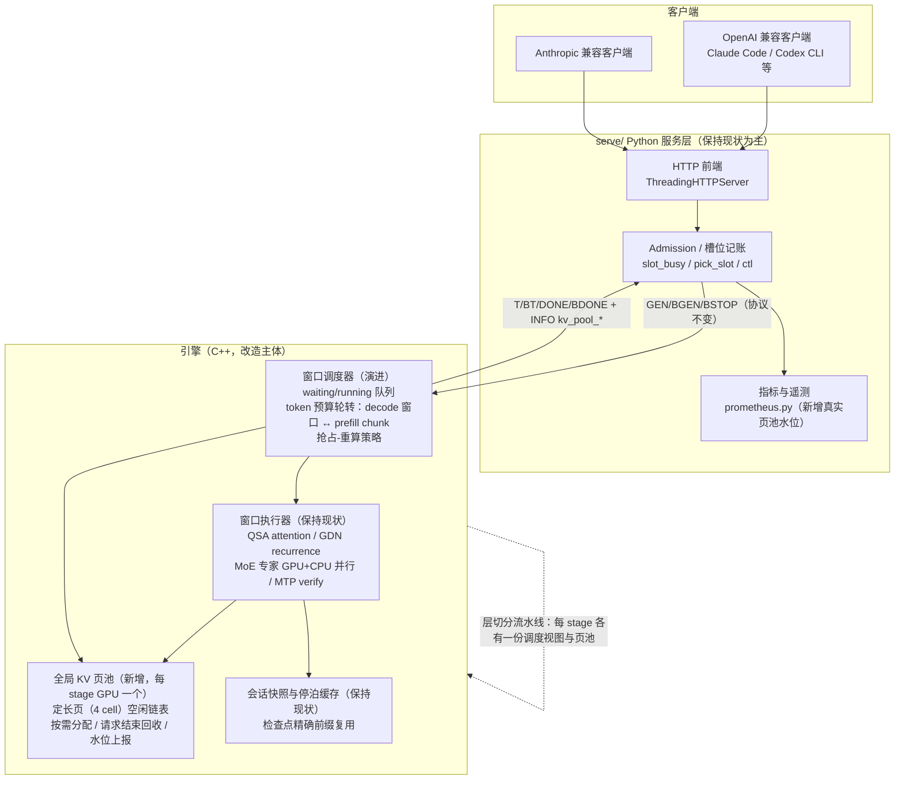
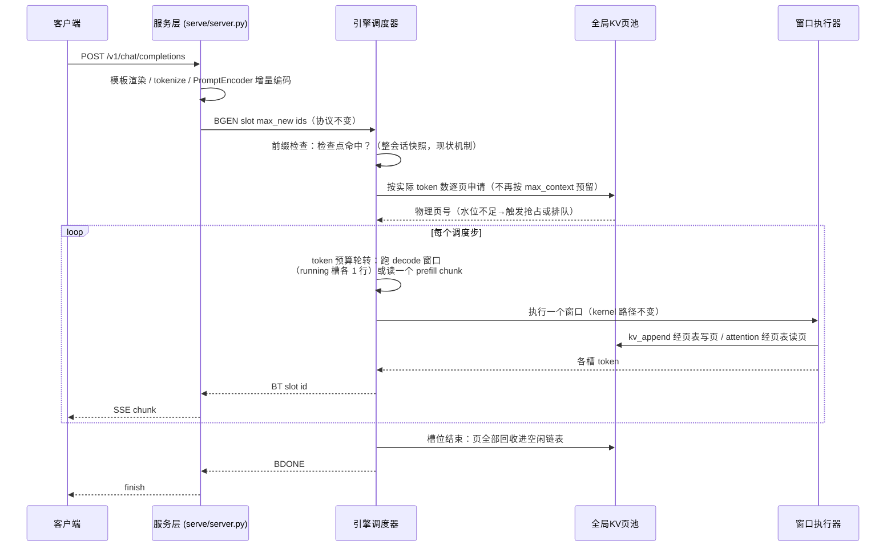

# Strata 基于vLLM思想推理优化改造设计文档

| 项 | 值 |
| --- | --- |
| 文档状态 | 设计评审稿 v2（经一轮独立代码核查修订：快照拷贝路径、收益数字链、kv_mode 1 取舍、调度器与既有机制冲突点） |
| 适用代码基线 | main @ 7ddc17a3（engine 0.1.48.1 / app 0.2.3.1） |
| 目标读者 | 推理引擎维护者、Reviewer |
| 范围 | 仅方案设计；不含实现代码（伪代码/原型在文档定稿后另行输出） |

> 本文所有对现状的描述均以仓库内代码与文档为准，关键结论标注了文件与行号，可逐条核对。

---

## 1. 项目背景与现状

### 1.1 Strata 原有能力、现有推理瓶颈

**Strata 定位（实际情况，替换任务书中的占位说明）：** Strata 是面向消费级 PC 的本地大模型推理引擎与服务框架，目标是"在游戏显卡 + 大内存的家用机上跑服务器级模型"。当前主力模型为 Qwen3.8-Flash-Next（125B 参数 MoE，24,576 个专家、每 token 激活 10 个，48 层混合架构：36 层 GDN/DeltaNet 线性递归 + 12 层 QSA 稀疏注意力）。引擎为自研 C++（CUDA/HIP/SYCL/Metal 四后端，HIP 经宏映射共享 CUDA 源），通过分层 offload 运行：稠密权重、路由器、共享专家、attention 与 KV 驻显存；全部 24,576 个专家 pin 在内存，未命中显存缓存的专家由 CPU 内核原地计算、与 GPU 并行（docs/HOW_IT_WORKS.md:20-33）。Python 服务层（serve/server.py）对外提供 OpenAI / Anthropic / Responses / llama.cpp 兼容 API，经 stdin/stdout 文本行协议驱动常驻引擎子进程（`GEN`/`BGEN`/`T`/`BT`/`DONE`/`BDONE`，docs/BATCHING.md:547-562）。

**与本次改造相关的现有机制清单：**

| 机制 | 现状 | 证据 |
| --- | --- | --- |
| KV 缓存布局 | **已分页**：`[page][kv_head][page_size=4][head_dim]`，每会话一张逻辑页→物理页页表，kernel 经页表间接寻址，且页表**不假设恒等**（有置换页表的 parity 测试） | include/strata/kernels/qsa.hpp:63-76,105,179；qsa.hpp:115 `s.page_size = 4` |
| KV 分配方式 | **缺省路径：每会话按 max_context 一次性预分配**，驻留模式（kv_mode 0）下页表即恒等映射；每槽位 32K 上下文 int8 的会话状态合计约 0.56 GiB，其中可分页的 QSA KV 部分约 0.39 GiB，其余为定长的 GDN 递归状态（约 0.11 GiB）、indexer pooled 状态（约 0.05 GiB）与 rope 表等；128K 流式模式每槽 pinned RAM 约 1.6 GB。**例外：** `--kv-grow` 已在 NVIDIA 单卡上用 VMM 实现"预留地址、按需映射"（layer.cpp:702-730,778,814-848），但 HIP 无 VMM（src/core/vmm.cpp:3 编译期排除）且无跨槽共享/回收语义 | src/core/layer.cpp:738-791（kv_plan/qsa_state_bytes）；docs/BATCHING.md:145-150；include/strata/core/layer.hpp:285-289 |
| KV 驻留策略 | kv_mode 0 全驻留 VRAM；kv_mode 1 流式（host 为权威副本 + VRAM 驻留窗口 ≥20480 cell，页表兼做驻留图，-1 未驻留）；kv_mode 2 MTP drafter 环形 | include/strata/core/layer.hpp:229,233-236；include/strata/kernels/kv_stream.hpp:5-12 |
| KV 量化 | FP16 / INT8 / Q4_0 / 混合 K8V4 四档（docs/DETAILS.md:79-97），均走同一分页布局（代码事实：kv_append/gather 各量化变体都收 page_table 参数，include/strata/kernels/kv_q8.hpp:12,33-43、kv_q4.hpp:46-61） | docs/DETAILS.md:79-97；上述头文件 |
| 批处理 | slot 制（`--batch N`，opt-in）：每窗口 ≤8 行（层切分流水线时每组 ≤8 行、可多组）；单请求独占时走带 MTP 投机解码的 solo 路径，第二请求到达时 STOP 后以 BGEN 迁入槽位；admission 串行独占控制线；长 prefill 按 chunk（2048-8192）与槽位解码按时间片交织（`STRATA_BATCH_DECODE_SHARE=0.5`）；BYIELD 协作式让路 | docs/BATCHING.md:1-8,159-189；serve/server.py:1139-1177（slot 记账） |
| 前缀复用 | 整会话快照 + 回合/周期检查点（精确 token 前缀匹配、LRU、根检查点常驻），会话可停泊进有界 host RAM 缓存（parking）；无跨请求任意前缀的块级共享 | docs/DETAILS.md:1135-1234 |
| 抢占 | **无**（vllm:num_preemptions_total 恒 0，"Strata does not preempt"） | serve/prometheus.py:95 |
| 多 GPU | 层切分流水线（pipeline，非张量并行）；每 stage 各持本段层的稠密权重（可 --trim-stage-weights 裁剪）与各槽位的会话状态；HIP 的 `--gpus` 目前仅 Linux，Windows HIP 一模型一卡 | docs/MULTI_GPU.md:1-12；docs/AMD_HIP.md:163 |
| 显存弹性 | VMM 分段映射的专家缓存（--vram-elastic，仅 NVIDIA）；KV 侧有 --kv-grow | docs/VRAM_ELASTIC.md:8-19,125 |
| 指标 | Prometheus 指标名已对齐 vLLM 命名（vllm:ttft/itl/kv_cache_usage_perc 等） | serve/prometheus.py:77-98 |

**现有瓶颈（本次改造要解决的痛点）：**

1. **KV 按"最坏情况"静态预留（缺省路径）。** 每个槽位按 max_context 整块预分配（0.56 GiB/槽 @32K int8 的会话总成本，其中 QSA KV 约 0.39 GiB；128K 流式 1.6 GB pinned RAM/槽），短会话与长会话同价。槽位数在启动期由显存一次性决定，运行时不可随实际用量弹性增减。需要如实说明：`--kv-grow`（VMM 按需映射）已在 NVIDIA 单卡上部分缓解"短会话同价"问题，但它不跨槽共享、不回收复用，且 HIP 不可用——瓶颈在 HIP/多槽场景依然完整存在。
2. **admission 串行 + 时间片启发式交织。** 新请求的 prompt 读取独占引擎控制线，与在解码槽位靠 `decode_share=0.5` 的固定时间比交替（docs/BATCHING.md:173-178），不是按 token 预算的统一调度；长 prompt 到达会显著拉长其他流的停顿，层切分流水线下缺省甚至是"读完才放行"（BATCHING.md:289-292），实测最长停顿 11.9-12.2 s（BATCHING.md:234,331,335）。已有两个 opt-in 缓解（`STRATA_PIPED_READ_PIECE` 分片读、`STRATA_PIPED_CONCURRENT` 独立线程并发读，BATCHING.md:191-353）——它们证明方向可行，但语义是环境变量级别的实验开关，且与若干特性互斥；本设计将其语义内化为正式调度。
3. **无抢占-重算。** 显存/KV 压力下只能排队或拒绝，不能把代价低的请求逐出后重算（prometheus.py:95）。
4. **无跨请求前缀块共享。** 复用单元是"整会话快照 + 精确前缀匹配"；多并发 agent 共享同一系统提示、或多个会话共享长文档前缀时，KV 各自全量持有。
5. **混合架构带来的特殊约束（必须正视）：** 48 层中仅 12 层 QSA 有随长度增长的 KV；36 层 GDN 的状态是**定长递归状态**，不可分页、不可按块共享、也无法从中间重构（没有检查点就必须重算前缀）。PagedAttention 的收益面天然只覆盖 1/4 的层——这既是限制，也使改造面大幅收窄（见 2.2、6.2）。

### 1.2 vLLM 核心机制简要回顾（仅与本次改造相关）

1. **PagedAttention 分页 KV 缓存。** KV 按定长 block（页）切分，全局物理块池 + 每序列块表（logical→physical），按需分配、引用计数、空闲块回收；块级哈希支持跨请求前缀共享（shared prefix 的块被多序列引用，写时复制）。收益：显存占用从"按上限预留"变为"按实际使用"，消除内部/外部碎片，同显存支撑更多并发。
2. **连续批处理（Continuous Batching / iteration-level scheduling）。** 调度以 iteration 为粒度：每个 step 重新决定 batch 组成，请求在完成当步即退出、新请求在有空位时立即加入，不等整批结束。收益：GPU 不空转，吞吐随并发近线性提升。
3. **预填充/解码调度分离。** waiting/running 双队列；decode 优先，prefill 以 chunked prefill 形式按 token 预算（max_num_batched_tokens）混入同一个 step；内存不足时按策略抢占（重算或换出）。收益：TTFT 与 TPOT 可分别调控，长 prompt 不再阻塞短请求的解码。

### 1.3 改造目标

| 类别 | 目标 | 度量 |
| --- | --- | --- |
| 性能 | 槽位 KV 显存占用与实际序列长度成正比，而非与 max_context 成正比 | 同配置下可承载槽位数 / 专家缓存让出的 GiB |
| 性能 | 并发下 TTFT 恶化收窄：长 prefill 到达时存量流的最长停顿显著下降 | 基准：BATCHING.md 实测的 11.9-12.2 s 级停顿（:234,:331,:335）→ 亚秒-秒级 |
| 性能 | 聚合吞吐在已有 slot 批之上不降，在 admission 密集场景提升 | 聚合 tok/s（8/16 并发） |
| 兼容 | 对外 HTTP API 零变化；全部新能力 opt-in，缺省配置行为与现状逐字节一致 | 回归测试（8.3） |
| 兼容 | greedy 输出与单跑逐 token 一致（仓库既有 bit-exact 文化） | tools/batch_test.py 系列 |
| 维护 | attention/GDN kernel 数值路径零改动；SYCL/Metal/无并发场景不回归 | 后端能力矩阵（3.4） |

---

## 2. 总体设计思路与选型原则

### 2.1 设计哲学：最小侵入、优雅改造，复用现有模块

三条原则：

1. **只换分配器与主机侧拷贝路径，不换数值 kernel。** Strata 的 QSA KV 已是分页布局，且 decode attention / kv_append / kv_gather 全部经页表间接寻址（qsa.hpp:179 明确页表"NOT assumed to be the identity"，qsa.hpp:75-77 记录了置换页表下输出必须完全一致的 parity 测试）。PagedAttention 化的 kernel 侧因此零改动；但**主机侧并非零改动**：快照/停泊/槽间直拷四条拷贝路径当前是对池基址的平铺物理前缀拷贝，隐含恒等页表假设（conversation_snapshot.cpp:165-177,223-264，快照格式自述为 identity-layout，DETAILS.md:1190-1191），页池化后必须改为经页表按页 gather/scatter（见 3.1）。这是本设计最大的主机侧改动点，必须在 MVP 内正面解决，不能回避。
2. **调度在引擎内演进，不上收服务层。** vLLM 把调度器放在 Python，前提是引擎暴露了细粒度 step 接口。Strata 的服务层-引擎间是逐 token 的文本行协议（server.py:1805, 2197-2201），控制面带宽不足以承载逐迭代调度；且 CUDA graph、专家自适应层、流式 KV 全部在引擎内。正确做法是**把 vLLM 的调度语义（token 预算、waiting/running、抢占）实现在引擎的窗口主循环里**，服务层维持现有 admission 角色。方案对比见 3.2。
3. **缺省路径不动。** 所有新能力 opt-in；不开关时行为与现状逐字节一致（仓库既有规则，AGENTS.md：The default path stays byte-identical）。

### 2.2 哪些 vLLM 能力引入，哪些不引入

**引入（按优先级）：**

| 能力 | 对应 vLLM 机制 | 引入理由 | 形态 |
| --- | --- | --- | --- |
| ① 全局 KV 页池 + 按需分配 | PagedAttention 的分配层 | 解决瓶颈 1（最大痛点）；kernel 已就绪，主机侧改动集中在快照拷贝路径（3.1 专项） | MVP 核心 |
| ② 迭代级连续批处理 | Continuous Batching | 解决瓶颈 2；现有 slot 窗口已具雏形（join/leave 存在但粗粒度），演进为 token 预算制 | 阶段 2 |
| ③ prefill/decode 预算分离 + 抢占重算 | chunked prefill 预算 + preemption | 解决瓶颈 2/3；复用现有 chunk 机制与检查点重算路径 | 阶段 2 |
| ④ 跨请求前缀页共享（可选） | vLLM prefix caching | 解决瓶颈 4；**注意收益仅为内存**（GDN 状态不可共享，算力省不了，见 6.2），故降级为阶段 3 可选 | 阶段 3 |

**不引入（及理由）：**

| 不引入 | 理由 |
| --- | --- |
| vLLM 整体调度器 / Python asyncio 服务层重写 | 协议带宽与 CUDA graph 约束（2.1 原则 2）；重写附带损失大、风险高，收益不对应 |
| PD 分离实例部署（prefill 实例 / decode 实例分布式拆分） | Strata 定位是单机消费硬件；replicas.py 的进程级数据并行已覆盖多卡数据并行需求 |
| 张量并行 | 消费卡无 NVLink，层切分流水线已验证是最优（docs/MULTI_GPU.md:9-12） |
| vLLM 投机解码框架 | 已有更贴合模型的 MTP draft + prompt lookup（HOW_IT_WORKS.md:35-46），不重复建设 |
| >8 行窗口的融合 attention/GDN kernel 重写 | 工程量大、数值风险高；16+ 槽已由"多组流水线"覆盖（BATCHING.md:99-108） |
| LoRA / 多模型 zoo / 采样器重写 | 与本次目标无关 |

### 2.3 整体架构框图

### 2.4 核心数据流

---

## 3. 核心模块详细设计

### 3.1 KV 缓存管理层（分页 KV / 内存池 / 页表 / 复用与回收）

**现状（改造对象）：** `kv_plan()`（src/core/layer.cpp:738-756）按 `max_cells` 计算页数并整池分配；驻留模式下页表为恒等映射；每槽位成本 = `kv_pool_bytes(slots) + 页表 + indexer pooled 状态 + rope 表`（qsa_state_bytes, layer.cpp:774-791），其中 GDN/indexer/rope 部分不随实际长度伸缩。**关键约束：** 快照保存/恢复（conversation_snapshot.cpp:165-177,254-264）、槽间直拷（:223-252，STRATA_SLOT_COPY_DIRECT 路径）与 verify 指纹（:315-356）全部是**对池基址起 N 字节的平铺 cudaMemcpyAsync，不经 page_table 间接寻址**，且增量复用优化假设"逻辑前缀=物理前缀"（:157,171-172）；快照格式自述为 identity-layout（docs/DETAILS.md:1190-1191）。页池化打破了这一假设，是 MVP 必须解决的第一优先级问题。

**设计：全局物理页池 `GlobalKvPool`。**

- **池结构：** 每个 stage GPU、每个 KV 格式档（fp16/int8/q4/k8v4）一个池；池内页定长（沿用 page_size=4 cell，与 QSA indexer 块对齐——一页恰好一个索引块，kv_stream.hpp:5）。池在引擎启动时一次 `cudaMalloc/hipMalloc` 成形，**不依赖 VMM**（这对 HIP 至关重要：HIP 无 VMM、vram-elastic 不可用，docs/VRAM_ELASTIC.md:16-19；静态大池在四后端上语义一致）。池容量由配置上限或"启动时剩余显存 × 比例"决定。
- **为什么这么做：** 复用已存在的分页间接寻址，kernel 零改动；定长页 → 无外部碎片；内部碎片 = 每序列末尾不足 4 cell，可忽略。
- **好处：** 槽位 KV 成本从 `max_context × 单价` 变为 `实际长度 × 单价`；槽位数变为纯调度上限，内存成为运行时动态约束。
- **代价：** 池为静态预留，空闲时不能自动让回专家缓存（可配上限缓解；与 `--kv-grow` 的演进关系见阶段 3）；页表项数 = 序列长度/4，128K 上下文 = 32K 项/层/序列，主机侧管理开销需实测（预计微秒级/窗口，见 5.2）。

**分配策略：** 会话页表仍 per-sequence（逻辑页→池物理页），`kv_append` 跨界时从空闲链表取页填入页表。为降低取页频率的主机开销，允许按 8 页一批预留（逻辑上仍逐页记账）。

**回收策略：** 请求结束/被逐出时，该序列全部页归还空闲链表（O(页数)）；池水位 = 已分配页/总页，经 `INFO kv_pool_pages=N kv_pool_free=M` 上报，服务层映射到 `vllm:kv_cache_usage_perc`（替换当前"当前请求占 context 比例"的近似语义，prometheus.py:77-82）。

**与既有机制的关系（必须逐一交代）：**

| 既有机制 | 关系 |
| --- | --- |
| kv_mode 0（全驻留） | MVP 支持范围：页池直接替换恒等预分配 |
| kv_mode 1（流式，host 权威副本 + VRAM 驻留窗口） | 阶段 2，且需修正初稿的轻率判断：host 权威副本当前按恒等布局平铺分配（kv_stream.hpp:3-4；layer.cpp:906-907），device 侧 resolve 拷贝 kernel 按逻辑块号**直接索引** host 副本（kv_stream.cu:105-153）——host 池化意味着该 kernel 要加一层 host 页表间接，这违背"kernel 零改动"承诺。**取舍：阶段 2 采用简化路线——host 副本不池化、仅改为按需分段提交（pinned RAM 分段 lock），VRAM 驻留窗口维持现状；跨会话 host 页共享不做。** 简化带来的约束：流式模式的 pinned RAM 收益仅限"按需提交"，不享受池化复用（5.1 第二行收益相应缩水，见该处修订） |
| kv_mode 2（MTP drafter 环形 KV） | 不动。环形缓冲定长，无池化收益 |
| 会话快照 / 停泊缓存 | **MVP 必须改造（不可回避）：** 四条平铺拷贝路径（save/restore/槽间直拷/verify 指纹）改为经页表按页 gather/scatter（见下文专项设计）；阶段 3 可选优化：快照持有页引用（写时复制），避免拷贝 |
| GDN 递归状态 / QSA indexer pooled 状态 / PLE history | 全部保持 per-session 预分配。GDN 状态定长（与上下文长度无关），indexer pooled 行数小（pooled_rows × idx_dim × 4 B），池化收益为零、风险非零 |
| `--kv-grow` / VMM 弹性 | MVP 互斥（池静态）；阶段 3 探索池底用 VMM 分段（仅 NVIDIA），HIP 保持静态池 |

**快照/拷贝路径改造专项（MVP 范围内的最大主机侧改动）：** 快照保存、恢复、槽间直拷、verify 指纹四条路径统一改为"经页表按页 gather/scatter"：按逻辑页序遍历页表，逐页从池物理页拷贝到快照镜像（保存），反向 scatter（恢复）；指纹按逻辑页序逐页哈希，保证与布局无关。方案对比：

| | 方案 A：逐页 gather/scatter（推荐） | 方案 B：页池与 parking/检查点互斥 |
| --- | --- | --- |
| 功能完整性 | 检查点/停泊/会话亲和全部可用 | 开启页池即失去会话复用，与 8.3 回归清单直接冲突 |
| 性能风险 | 8K 页 × 4224 B 的碎拷贝，吞吐需实测；可用每 8 页一批的批量拷贝缓解 | 无 |
| 改动面 | conversation_snapshot.cpp 四条路径 + conversation_copy.hpp | 几乎为零，但功能倒退不可接受 |
| 结论 | **采用**；性能实测列为阶段 1 验证项 | 否决 |

**CUDA graph 兼容性论证（关键可行性点）：** 引擎的 QSA 层被捕获为 CUDA graph，图在捕获时冻结 kernel 参数（qsa.hpp:140-145 为此专门把可变计数移进 device 内存）。经评审核对代码后，该论证比初稿更强：capturable 入口一律按**容量**而非实际长度定型 launch（qsa.hpp:326-340；layer.cpp:1250-1259 以 `max_cells` 推算 `max_blocks`/`cap`），cell_scores/idx_pooled/rope 均按 per-slot max_cells 静态尺寸（layer.cpp:787-790,883-891,1015-1028），与页池无耦合；页表是 device 内存、graph 只冻结其指针（layer.cpp:865,1000），内容变化不需重捕获；既有 `--kv-grow` 路径（layer.hpp:287-288"地址永不移动"）正是同一不变量的工程先例。**残留风险（写入不变量）：** ① 页分配必须发生在窗口 launch 之前（主机侧），窗口执行期间禁止页表结构性变更；② MTP verify 被拒的 draft 所占页必须可回收（drafter 是 kv_mode 2 环形，不在池内——此风险天然不存在，但主路径 append 与拒绝回滚的页记账需在实现时以断言固化）。此论证需以 parity 测试族实测收口（8.1）。

**页大小取舍（方案 A/B）：**

| | 方案 A：沿用 4 cell 页（推荐） | 方案 B：逻辑块聚合（如 16 页=64 cell 为分配单位） |
| --- | --- | --- |
| kernel 改动 | 零 | 零（分配单位是主机侧概念） |
| 页表项数（128K） | 32,768 项/层 | 2,048 块/层（块内页连续分配） |
| 内部碎片 | ≤3 cell | ≤63 cell |
| 与 indexer 块对齐 | 天然对齐 | 需块边界对齐到索引块，无额外收益 |
| 结论 | **MVP 采用**；若实测主机侧页表管理成为热点再演进 B | 备选优化，非必需 |

### 3.2 批处理调度器（连续批处理 / prefill-decode 队列分离 / 调度策略）

**现状（演进基础）：** slot 窗口 ≤8 行；join=串行 admission（BGEN），leave=BDONE；prefill 与 decode 以"每 chunk 后解码 chunk 耗时 ×0.5"的时间片交织（BATCHING.md:173-178）；BYIELD 让路；`STRATA_ADMIT_SHORT_FIRST` 短提示优先。

**设计：迭代级窗口调度器（引擎内）。** 每个调度步由调度器按以下规则决策：

1. **decode 优先：** running 集合中每槽出 1 行（带 `--batch-mtp` 时为 2 行：当前 token + 提案）。
2. **prefill 按 token 预算轮转（重要澄清）：** Strata 的 prefill 与 decode 走两条完全不同的执行路径（prefill.cpp/qsa_prompt_attn.cu 的批量 GEMM 路径 vs verify.cpp 的逐 token 窗口），**把两者融合进同一窗口意味着重写执行器，本设计明确不做**。本设计实现的是**窗口粒度的 token 预算轮转**：以 `max_batched_tokens` 预算（缺省 = 一个 prefill chunk，2048-8192 可调）决定"本轮读一个 prefill chunk 还是跑若干 decode 窗口"，取代 `decode_share=0.5` 的固定时间比——从"时间比"变为"token 预算"，长 prompt 对解码流的影响变得有界且可配置。这是预算化的 decode_share，而非 vLLM 字面意义的同窗口混排；承认这一简化及其约束：单步内 prefill 与 decode 仍不同时占 GPU（与现状相同），调度密度与公平性提升，执行器零改动。真正的同窗口混排列为阶段 3 之外的可选项，需单独评审。
3. **admission 去独占化：** 新请求不再需要"停止一切、独占控制线读完整个 prompt"；首个 chunk 在预算轮转中读完即产生首 token、进 running。简化约束：引擎窗口主循环仍是单线程，不引入引擎内多线程调度。
4. **抢占-重算：** 页池水位越限且 admission 饥饿时，选择"重算代价最小"的 running 槽（有最近检查点、已生成短的优先）逐出回 waiting 队列，释放其 KV 页。语义细节（评审补充，必须写明）：被逐槽的 **GDN/indexer/rope 等 per-slot 定长状态保留在槽内**（只释放可分页的 KV 页）；恢复时从最近检查点（回合开始处与每 16K prompt token 处，DETAILS.md:1136-1137）重新 prefill 增量——生成中段被逐需重读已生成 token，可行但有成本，选 victim 时优先选"距检查点近"的槽；服务层 `slot_held`/`pick_slot` 的会话亲和记账（server.py:1162-1164）不变，被逐槽标记 preempted 而非释放。复用 BYIELD 已验证的"已读部分暂存槽位"机制（BATCHING.md:179-182）。换出式抢占（状态拷 host）不做——停泊缓存已是等价物且更粗粒度，见 6.2。
5. **公平与防饿死：** waiting 队列 FCFS + 短提示优先（沿用 ADMIT_SHORT_FIRST 语义）；等待超 `STRATA_ADMIT_MAX_WAIT_S`（默认 30 s）升级为最高优先。

**与既有机制的冲突点（评审补充，逐一交代）：**

- **流水线组（--batch-groups>1）：** 现状下 prompt 一读到底、所有槽位停摆，DECODE_SHARE 不适用（BATCHING.md:289-292），且"piece 结束才 drain pipeline"（:294-298）的约束意味着预算轮转在流水线上只能以 piece 为粒度生效。本设计在流水线路径上**直接吸纳 `STRATA_PIPED_READ_PIECE` 的语义为正式调度**（piece=预算内 chunk 数），不另造机制；`STRATA_PIPED_CONCURRENT`（独立线程并发读）保持 opt-in 实验特性不变。
- **专家自适应层：** 批窗口每 `--adapt-every` 轮驱动专家换入换出（BATCHING.md:357-366）；预算轮转改变窗口节奏，路由统计口径不变（仍按窗口计数），但 adapt 时机跟随新节奏——需在测试中对齐 `--adapt-every 1000000` 精确设置。流水线组路径不 adapt（现状），不变。
- **`STRATA_BATCH_ATTN_ROWS=1`：** 多行合一 launch 时各槽 KV 池指针按值作 kernel 参数传入（BATCHING.md:478-486）；页池化后变为共享池基址 + 逐行页表指针——参数形态变化需专项验证（graph 捕获重录），**初版与页池互斥，验证后再放开**。
- **图片 prompt：** 含图请求沿用现状路径，不参与预算轮转（现状限制原样继承，BATCHING.md:429-430）。

**方案对比（调度器放哪）：**

| | 方案 A：引擎内演进（推荐） | 方案 B：上收服务层（Python 调度循环，引擎退化为 step 执行器） |
| --- | --- | --- |
| 协议 | 现有文本行协议可承载（admission 粒度不变，仅窗口组成内部化） | 需逐迭代控制：文本行协议带宽/解析成本不可接受，必须先做二进制协议（共享内存或长度前缀帧） |
| CUDA graph / 专家自适应 / 流式 KV | 全部留在引擎内，零扰动 | 调度器需要感知每窗口的专家 miss、KV 驻留状态，跨进程暴露这些状态成本高 |
| 测试资产 | test_parallel.py 的 fake 引擎协议测试继续有效 | 全部协议测试需重写 |
| 灵活性 | 策略用 C++ 写，迭代慢于 Python | 策略即 Python，调参快 |
| 风险 | 中（窗口主循环复杂度上升） | 高（等于重写引擎-服务边界） |
| 结论 | **MVP 与阶段 2 采用** | 列为远期演进（阶段 3 之外），前提是先有二进制协议 |

**与既有开关的关系：** 新调度器开启时，`STRATA_BATCH_DECODE_SHARE` 被 `max_batched_tokens` 预算轮转取代（保留为旧模式兜底）；BYIELD 保留为"页池未启用时的降级路径"；`--batch-groups` 流水线语义不变（每组独立窗口，调度器逐组决策，prefill 以 piece 粒度轮转，见上）。

### 3.3 与 Strata 原有模块的对接方式（侵入程度评估）

**形态：新增独立子模块 + 既有分配点改线，不动 kernel、不动协议主体。**

| 落点 | 改动 | 侵入度 |
| --- | --- | --- |
| 新增 `src/core/kv_pool.*` | GlobalKvPool：空闲链表、按批取页、水位统计、页表填充助手 | 新增，零侵入 |
| `src/core/layer.cpp`（kv_plan / qsa_state_init / qsa_state_bytes） | 池启用时：KV 池字节不再计入每会话状态，页表由池填充 | 中（单文件、路径清晰） |
| `src/core/session.cpp`（会话 carve） | 会话内存估算扣除 KV 池部分 | 小 |
| `src/core/verify.cpp`（窗口行组装） | 不变（行仍读各槽 QsaState 页表） | 零 |
| `src/core/conversation_snapshot.cpp` + `conversation_copy.hpp` | save/restore/槽间直拷/verify 指纹四条平铺拷贝路径改为经页表按页 gather/scatter（3.1 专项） | **中（MVP 最大主机侧改动点之一）** |
| `src/program/generate.cpp`（窗口主循环 / admission） | 调度器主体：waiting/running 队列、token 预算轮转、抢占决策 | 中大（本设计最大改动点） |
| 协议（GEN/BGEN/INFO） | 仅新增 `INFO kv_pool_pages/free` 与能力位；命令集不变 | 小 |
| serve/server.py | slot 记账、pick_slot、取消通路全部保留；读取新 INFO 更新指标 | 小 |
| serve/prometheus.py | `vllm:kv_cache_usage_perc` 改接真实池水位；`vllm:num_preemptions_total` 接通真实计数 | 小 |

### 3.4 模型后端适配层（兼容原有后端，与推理后端解耦）

**原则：后端零新增 kernel。** 池分配器只调用既有 platform 抽象（设备分配/拷贝），不触碰 attention/GDN/专家 kernel 的数值路径；CUDA 与 HIP 共享 `.cu` 源（宏映射），自动同获能力；但"自动获得"不等于"已验证"。

| 后端 | 页池 | 迭代级调度 | 说明 |
| --- | --- | --- | --- |
| CUDA（Linux/Windows） | 支持 | 支持 | 主验证平台 |
| HIP（Linux，gfx1100/1200 等） | 支持（静态池，不依赖 VMM） | 支持，需验证 | 双 7900 XTX 场景所在；窗口优先级、门铃等并发特性在 HIP 有既有差异先例（BATCHING.md:224-225），列为验证项 |
| HIP（Windows） | 支持（单卡场景） | 支持，需验证 | 一模型一卡（--gpus 仅 Linux，AMD_HIP.md:163）；双卡只能双实例数据并行 |
| SYCL / Metal | 默认关闭（配置门控 + INFO 能力位） | 默认关闭 | 不回归为底线；后续按需求开启 |

多 GPU 层切分下，每 stage GPU 各持一个页池与调度视图（沿用"每槽在每 stage 各有一份会话状态"的现有结构，BATCHING.md:90），调度决策由 stage 0 发起、水位取各 stage 最小值——与现有"每 stage 窗口对齐"的流水线约束一致，不引入新的跨卡同步。

---

## 4. 接口与兼容性设计

### 4.1 对外接口是否改动

**不改。** OpenAI（/v1/chat/completions、/v1/responses）、Anthropic（/v1/messages）、llama.cpp（/props、/slots）兼容端点、SSE 流式语义、API key/Origin 检查全部保持。扩展仅限只读观测面：`GET /v1/status` 增加 `kv_pool` 对象（pages/free/watermark），`/metrics` 的 `live.slots` 增加每槽实际占用页数。均为新增字段，无删改。

### 4.2 配置项新增范围

| 配置（config `args` 或顶层键） | 缺省 | 说明 |
| --- | --- | --- |
| `--kv-pool` / `"kv_pool": true` | 关 | 启用全局 KV 页池（总开关，opt-in） |
| `--kv-pool-mib N` | 启动时剩余显存 × 50% | 池容量上限（每 stage） |
| `--max-batched-tokens N` | 一个 prefill chunk（8192） | 窗口 token 预算（阶段 2） |
| `--preempt-mode recompute|off` | off | 抢占策略（阶段 2） |
| `--kv-prefix-share` | 关 | 跨请求前缀页共享（阶段 3，可选） |

缺省（全部开关关闭）= 现状逐字节行为；setup 推荐逻辑初期不主动开启，待基准数据齐全后再纳入推荐。

### 4.3 存量任务、会话 KV 缓存迁移兼容方案

- **SAVE/RESTORE 会话文件：** 文件存的是**恒等布局的逻辑 KV 字节流**（conversation_file.cpp；快照格式自述 identity-layout，DETAILS.md:1190-1191）。池化引擎的 RESTORE 须把文件内容按逻辑页序 scatter 进池页（即 3.1 的 gather/scatter 改造覆盖此路径），旧引擎 SAVE 的文件因此可在新引擎恢复，新引擎 SAVE 仍写恒等布局、可在旧引擎恢复。格式版本不 bump，但"恢复"不再是整块 memcpy——这是 4.3 中唯一的实现注意点。
- **检查点 / 停泊缓存：** 内存态机制，随引擎进程生命周期，升级即失效重建，无迁移负担。
- **配置：** 旧 config 不含新键时行为不变；含新键的 config 在旧引擎上启动时按未知参数告警处理（沿用既有未知参数策略）。
- **回退：** 任意阶段可通过关开关回到现状路径；无持久状态需要回滚。

---

## 5. 性能预期 & 资源测算

### 5.1 预期收益（含双 7900 XTX + 128 GB 内存场景测算）

**测算基线（双 7900 XTX，gfx1100，24 GiB × 2，128 GB RAM）：** Linux + HIP 层切分 24/24 + `--trim-stage-weights`；IQ3_S（模型文件约 46-55 GB，全量专家 pin 于 128 GB RAM 无压力）；32K-128K 上下文；int8 或 k8v4 KV。Windows 下 HIP 不支持层切分，双卡只能跑两个独立模型实例（数据并行），此时页池收益体现在单实例多槽场景。以下数字为基于仓库既有实测单价的**估算**，需以 8.2 的基准实测收口。

| 收益点 | 机理 | 估算 |
| --- | --- | --- |
| 槽位 KV 按需占用 | 现状 8 槽 @32K int8 在启动期从专家缓存预扣 8 × 0.56 GiB ≈ **4.5 GiB（每 stage）**；池化后只有 QSA KV 部分（0.39 GiB/槽 @32K）随实际长度伸缩，GDN/indexer/rope（约 0.17 GiB/槽）仍为 per-slot 定长预分配。典型 agent 会话 8K 实占 ≈ 0.10(KV) + 0.17 ≈ **0.27 GiB/槽** → 8 槽 ≈ 2.2 GiB | **同等服务能力下每 stage 让回约 2.3 GiB 给专家缓存 ≈ 多驻留约 1,600 个专家**（按 ~700 专家/GiB，HOW_IT_WORKS.md:25-26），约占全部专家的 6.6%——在专家未全驻留的配置上直接转化为 decode 速度。注意：收益与平均会话长度强相关，长会话占比高时收益趋近于零 |
| 长上下文多会话（流式模式） | 128K 流式现状每槽 1.6 GB pinned RAM 预留；按阶段 2 的简化路线（host 副本按需分段提交，不池化） | 16 个平均 16K 的会话：host 副本从 25.6 GB 预留降为按实际提交约 3.2 GB——**收益来自"按需提交"而非池化复用**；会话结束后 host 段可回收（分段 lock/unlock），但不跨会话共享 |
| TTFT（admission 密集） | token 预算轮转取代串行独占 admission + 时间片 | 参照 BATCHING.md:227-241 实测：提示与流并发读的改造使流最长停顿从 11.9 s 降至 0.8 s 级；本设计把同等语义内化为调度器默认行为，预期长 prefill 到达时存量流最长停顿进入亚秒-秒级 |
| 聚合吞吐 | slot 批之上，slot 数不再受"最坏情况显存"钳制 | 参照 4×R9700（32 GB×4，IQ3_S **专家全驻留**）实测：8→16 槽在**全部 opt-in 开关开启**时 +40.7%~+55.8%，无开关臂仅 +15%~+21%（BATCHING.md:129-137）——增益强依赖专家驻留率与配套开关。双 7900 XTX 专家驻留率约 60-70%（估算），并发吞吐增益以延迟为主、吞吐为辅——**小显存 offload 场景并发不省 CPU 专家算力**（BATCHING.md:145-150 的 12 GB 卡实测并发反而慢 11-24%），必须如实预期 |
| 前缀共享（阶段 3） | 共享系统提示/长文档的 12 层 QSA KV 页 | 16 个并发 agent 共享 4K 系统提示：省 15 × 12 层 × 4K token × 约 1.06 KB/token(int8) ≈ **0.8 GB**；**不省算力**（GDN 前缀重算不可避免），TTFT 收益仍主要来自既有检查点机制 |

**改造前后对比总表：**

| 维度 | 改造前 | 改造后 |
| --- | --- | --- |
| 槽位内存成本 | max_context 预分配（0.56 GiB @32K，其中 KV 0.39 GiB） | KV 部分按实际长度 × 单价 + 定长状态（8K 会话 ≈ 0.27 GiB） |
| 槽位数约束 | 启动期按最坏情况定死 | 调度上限 + 运行时页池水位双重约束 |
| prefill/decode 关系 | 串行 admission + 时间片 0.5 | 统一 token 预算，decode 优先 |
| 显存压力应对 | 排队/拒绝 | 抢占-重算 + 排队 |
| 前缀复用 | 整会话快照精确匹配 | + 可选块级共享（阶段 3） |
| 观测 | kv_cache_usage 为近似值 | 真实页池水位 + 真实抢占计数 |

### 5.2 资源开销估算

| 开销 | 估算 | 说明 |
| --- | --- | --- |
| CPU：页表/空闲链表管理 | 每窗口微秒级 | 8 槽 × 12 层，每槽每窗口至多取 1 页（decode）；prefill chunk 8192 token = 2048 页/层的批量填表，为连续内存写 |
| GPU：快照 gather/scatter | 每页一次 4224 B 拷贝，按 8 页一批合批 | 8K 会话约 2,000 页/层 × 12 层的碎拷贝；吞吐影响需实测（列为阶段 1 验证项），会话快照是低频操作，预期可接受 |
| 显存：页表本体 | 128K 上下文 32K 项 × 4 B × 12 层 ≈ 1.5 MB/序列 | 现状同量级（页表本就存在），增量≈0 |
| 显存：池静态预留 | 可配上限 | 池空闲时不自动让回专家缓存（与 --vram-elastic 的段级弹性不同），由 `--kv-pool-mib` 控制 |
| pinned RAM：流式模式 host 副本 | 按需分段提交，总量按实际上限 | 阶段 2 简化路线：不做跨会话池化（3.1 kv_mode 1 行的取舍说明） |

### 5.3 压力场景边界

- **长上下文 × 高并发：** 页池水位 100% 时的行为顺序：新 admission 排队 → 抢占-重算低代价槽 → 拒绝（HTTP 429 admission_full，沿用现有限流）。绝不 OOM 崩溃——池容量在启动时静态确定。**prefill 中途耗尽的行为**（评审补充，必须定义）：prefill 按 chunk 进行，取页失败发生在 chunk 边界 → 该请求已读部分按 BYIELD 同构路径暂存槽位、回 waiting 队列等待水位回落；不允许请求中途失败——这是与现有让路机制对齐的选择，代价是长 prompt 在内存紧张时可能多次往返。
- **吞吐天花板不在 KV：** MoE offload 架构下，并发窗口读到的**不同专家数随并发线性增长**（不同会话路由到不同专家），CPU 专家池算力是小显存配置的真实天花板。双 7900 XTX（专家驻留率 60-70% 估算）处于"吞吐与延迟均有收益"与"仅延迟收益"的过渡带，需实测定位。
- **128K × 16 会话 × 流式 KV：** host 池 pinned RAM 按上限封顶；驻留窗口（≥20480 cell）逻辑不变，页池化不恶化也不改善驻留 miss 率。
- **极限不变量：** 窗口行数上限 8/组不变；单流极限速度不变（solo 路径不动）；最大上下文长度不变。

---

## 6. 风险、取舍与局限性

### 6.1 改造带来的风险点

| 风险 | 影响 | 缓解 |
| --- | --- | --- |
| **快照/停泊/槽间拷贝的恒等布局假设被打破（MVP 最大风险）** | 错算或指纹不匹配，且是静默的 | 四条路径统一改经页表 gather/scatter（3.1 专项）；指纹按逻辑页序哈希保证布局无关；parking_test.py + batch_interleave_test.py 全覆盖为阶段 1 门禁 |
| CUDA graph 固定地址假设被破坏 | 崩溃或静默错算 | 3.1 的兼容性论证（容量定型 launch + 页表内容可读）+ 置换页表 parity 测试族扩展为回归门禁；池基址终身不变、"窗口 launch 前完成页分配"写为不变量断言 |
| 页池与流式 KV（kv_mode 1）交互 | 长上下文场景错算 | 阶段 2 采用简化路线：host 副本不池化、仅按需分段提交，resolve 拷贝 kernel 不动；跨会话 host 页共享明确不做 |
| 调度器引入新竞态 | 挂死/错序 | 本仓库 admission 路径有按 issue 编号的竞态修复史（#1012/#1603/#1994 等），教训是必须带着 test_parallel.py 无 GPU 协议测试族一起走；调度器决策全部收敛在窗口主循环单线程内，不新增引擎内线程 |
| bit-exactness 漂移 | 违背仓库文化 | 池化不改变任何数值路径（页地址变化不影响 attention 数学）；调度不改变行内算术（BATCHING.md 的 exactness 论证原样适用）；测试沿用 `--pcie-frac 0 --adapt-every 1000000` 精确对齐设置；`STRATA_BATCH_ATTN_ROWS=1` 初版与页池互斥 |
| HIP gfx1100 验证缺口 | 目标场景翻车 | 双 7900 XTX 是一等验证平台（8.2 单列）；HIP 无 VMM 已由"静态池"设计规避；Windows HIP 无双卡层切分是平台现状，文档明示 |
| 池碎片（长期运行） | 水位虚高 | 定长页无外部碎片；唯一风险是会话末尾部分页，量级可忽略 |

### 6.2 主动放弃的特性、权衡说明

| 放弃 | 权衡说明 |
| --- | --- |
| 块级前缀共享进 MVP | **GDN 递归状态不可从中间重构**：共享前缀只省 12 层 QSA 的 KV 内存，36 层 GDN + 专家 FFN 的前缀算力一分省不了。既有整会话检查点机制在 TTFT 上严格更优（省全部算力）。前缀共享仅剩"多会话同时在线时的内存密度"价值 → 降级为阶段 3 可选 |
| 换出式抢占（状态拷 host 再换回） | 重算式已复用检查点路径，零新增机制；换出式等价于把停泊缓存做成逐请求粒度，收益不抵复杂度 |
| >8 行窗口融合 kernel | 数值风险与工程量大；16+ 并发已由多组流水线覆盖 |
| 服务层 asyncio 化 / 调度上收 | 见 3.2 方案对比；协议未二进制化前不做 |
| vLLM 其余生态（LoRA、多模型、PD 分离部署） | 与单机消费级定位不符 |

### 6.3 不适合的使用场景

- **单用户桌面对话（无并发）：** 页池与调度器是纯开销（可忽略但无收益），保持缺省关闭即可。
- **12-16 GB 小卡、专家主要在 CPU 的配置：** 并发买延迟不买吞吐（实测慢 11-24%，BATCHING.md:440-458），页池的内存收益也会优先被专家缓存吃掉——收益真实但间接。
- **Windows + 双 7900 XTX 想跑单模型层切分：** HIP 平台现状不支持（--gpus 仅 Linux），需 Linux 或接受双实例数据并行。
- **要求逐比特确定性的采样业务之外的极端长上下文（>128K）单流场景：** 现状流式 KV 已优化，页池无增量价值。

---

## 7. 分阶段落地计划（MVP 优先）

### 阶段 1：最小验证版本（MVP）——全局 KV 页池

**范围：** 3.1 的 kv_mode 0（全驻留）部分：`GlobalKvPool` + 按需分配 + 结束回收 + 水位 INFO/指标；**以及快照/停泊/槽间直拷/verify 指纹四条路径的页表 gather/scatter 改造（不可回避，见 3.1 专项）**。调度器、流式模式、前缀共享、抢占全部不做。开关 `--kv-pool`，缺省关；`STRATA_BATCH_ATTN_ROWS=1` 与页池互斥。

**验证指标（全部通过才算完成）：**
1. 开关开启/关闭下 greedy 输出逐 token 一致（tools/batch_test.py 设置族）；
2. 池容量配置为 8 槽 @32K **KV 部分**现状预留（8 × 0.39 ≈ 3.1 GiB/stage）的 1/4（≈0.79 GiB）时，8 槽典型负载（≤8K 实际长度）全程无因页池耗尽的排队/拒绝；等池容对比下专家缓存多驻留专家数可测；
3. 单流 TTFT/TPOT 零回归（±2% 内）；快照保存/恢复与停泊往返的延迟回归 ≤10%（碎拷贝开销实测）；
4. ctest 与 serve/ 无 GPU 协议测试全绿。

### 阶段 2：调度与流式模式完善

**范围：** 迭代级 token 预算轮转调度（3.2，含流水线组上吸纳 PIPED_READ_PIECE 语义）、抢占-重算、kv_mode 1 的 host 副本按需分段提交（**不池化**，3.1 的取舍）、prometheus 真实抢占计数。

**验证指标：** 16 并发 admission 密集负载下存量流最长停顿 ≤2 s（对比现状 11.9-12.2 s 级，BATCHING.md:234,331,335）；聚合吞吐不低于阶段 1；抢占触发时无错算（batch_interleave_test.py 扩展用例）。

### 阶段 3：可选高级特性扩展（独立评审、可全部不做）

- 跨请求前缀页共享（写时复制 + 块哈希索引；可借鉴 replicas.py:122-159 的 64-token 块链式哈希**思路**——其代码基于 Python 内建 hash()，进程间随机化，不可直接复用，需用稳定哈希重新实现）；
- 快照持有页引用（免拷贝）；
- 池容量 VMM 化（仅 NVIDIA）与 `--kv-grow` 统一；
- 槽位数运行时弹性（突破启动期 --batch N 上限）。

---

## 8. 验证方案 & 测试指标

### 8.1 功能测试用例方向

| 层 | 用例 | 工具 |
| --- | --- | --- |
| 单元 | 页池分配/回收/水位/耗尽行为；页表填充正确性（置换页表 parity 扩展） | 新增 kv_pool 单测 + qsa.hpp:75-77 既有 parity 族 |
| 引擎集成 | 批内每槽 == 单跑逐 token；长 prefill 交织；让路/抢占恢复；停泊缓存往返 | tools/batch_test.py、batch_interleave_test.py、parking_test.py（全部带 `--pcie-frac 0 --adapt-every 1000000` 精确设置） |
| 服务层 | admission 顺序、断连取消、槽位记账、新指标字段 | serve/test_parallel.py、test_admit_order.py、test_slot_alloc.py、early_close_test.py（fake 引擎，无 GPU） |

### 8.2 基准测试指标

- **指标：** TTFT（p50/p90）、TPOT、聚合 tok/s、并发上限（不触发排队拒绝的最大并发）、显存水位（每 stage 页池占用 vs 专家缓存变化）、pinned RAM 水位。
- **双 7900 XTX 基准配置（一等验证平台）：**
  - Linux + HIP，`--backend hip --gpus 0,1`，层切分 24/24 + `--trim-stage-weights`，IQ3_S，32K 与 128K（`--kv-resident 32768`）两档，`--batch 8`；
  - 负载：BATCHING.md 实测同构（800 词 essay × N 并发、256-400 token 回答、greedy + temperature 0.7 两档；16 agent × 3 回合 follow-up 场景）；
  - 对照臂：开关关（现状）、开关开（页池）、页池+调度（阶段 2）。
- **对照平台：** 单 12 GB 卡（验证"无收益场景无回归"）、4×R9700（验证流水线组语义）。

### 8.3 回归测试方案（保证原有功能不破坏）

1. **默认路径逐字节一致：** 全部开关关闭时，引擎二进制行为与基线逐字节一致（AGENTS.md 既有规则）；六条 greedy 回答 SHA-256 对齐（BATCHING.md:240 的方法）。
2. **既有测试族全绿：** ctest（含 HIP 构建的 ctest）、serve/ 全部 pytest、tools/ 四个驱动脚本。
3. **专项回归清单：** 图片请求（prefill 含图不参与预算轮转，沿用现状路径）、SAVE/RESTORE 与 `--parallel` 互斥语义、`/v1/vram` 弹性接口与页池的互斥说明、会话停泊缓存交替会话场景（页池化后的 gather/scatter 正确性）。

---

## 9. 附录

### 9.1 关键术语

| 术语 | 说明 |
| --- | --- |
| PagedAttention | vLLM 提出的 KV 缓存分页管理：定长物理页 + 每序列块表 + 全局页池，按需分配、引用计数、前缀共享 |
| 连续批处理（Continuous Batching） | 以 iteration 为粒度调度，请求逐 step 进出 batch，不等整批结束 |
| chunked prefill / token 预算 | 长 prompt 切块，每 step 按 max_batched_tokens 预算与 decode 行混排（vLLM 语义；本设计 3.2 采用其简化形"预算化轮转"，执行器不混排） |
| TTFT / TPOT | 首 token 延迟 / 每输出 token 间隔 |
| QSA | 本模型的稀疏注意力层（12 层）：indexer 块打分 → top-k 选块 → 仅对选中块做注意力；KV 页 = 4 cell = 1 索引块 |
| GDN | 本模型的线性递归层（36 层，DeltaNet 系）：定长递归状态，无随长度增长的 KV |
| MTP | 模型自带的草稿层投机解码：一次 verify 窗口平均产出 2.4-3.2 token |
| kv_mode 0/1/2 | Strata KV 驻留策略：全驻留 VRAM / host 权威+VRAM 驻留窗口流式 / MTP drafter 环形 |
| 层切分（layer split） | 多卡流水线并行：各卡持连续层段与自有专家缓存，非张量并行 |
| 停泊缓存（parking） | 整会话快照的有界 host RAM 缓存，按前缀命中恢复 |
| VMM | 驱动虚拟内存管理（cudaMallocAsync 族）；HIP 不可用 |

### 9.2 备选方案对比

| | 方案 A：本设计（引擎内页池 + 调度演进） | 方案 B：服务层调度上收 + 二进制协议 | 方案 C：直接替换/外接 vLLM | 方案 D：不做改造，仅配置调优 |
| --- | --- | --- | --- | --- |
| 核心思路 | 复用已分页 kernel，只换分配器与主机侧拷贝路径；调度语义在窗口主循环内实现 | 引擎退化为 step 执行器，Python 实现 vLLM 式调度循环 | 用 vLLM 承载模型，Strata 退为前端 | 调整 parallel/prefill/decode_share 等现有开关 |
| 侵入度 | 中（1 个新模块 + 2 个改动集中点） | 高（引擎-服务边界重写） | 极高（放弃自研引擎与 offload 体系） | 零 |
| 能否解决痛点 1（KV 静态预留） | 能 | 能 | 能 | 不能 |
| 能否解决痛点 2（admission 串行） | 能 | 能 | 能 | 部分（调参缓解） |
| 混合架构适配 | 原生 | 原生 | **缺失**：vLLM 对该 MoE-offload + 混合架构组合无现成支持，24576 专家 CPU offload 体系需全部重建 | 原生 |
| HIP/双 7900 XTX | 静态池规避 VMM 缺失 | 同 A | vLLM ROCm 支持不含本模型 offload 路径 | 现状已支持 |
| 风险 | 中 | 高（瓶颈是协议带宽而非引擎能力——STRATA_PIPED_CONCURRENT 已证明引擎内并发读可行，方案 B 的真正门槛是逐迭代控制面需要二进制协议） | 不可接受（重写量级） | 无 |
| 结论 | **推荐** | 远期演进（协议二进制化后再议） | 否决 | 作为阶段 1 的对照臂 |

---

**文档结束。** 定稿后的下一步：按第 7 章阶段 1 范围输出实现级伪代码与模块接口定义，再进入编码。
